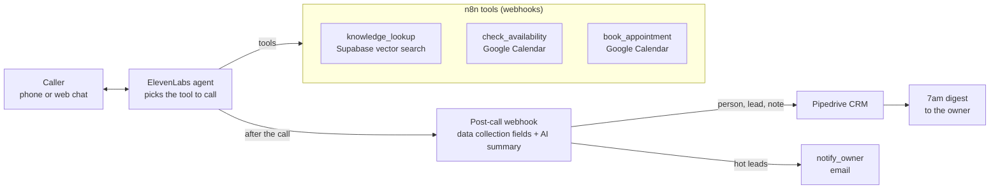

# Lead Catcher

An after-hours AI receptionist for small service businesses. A caller phones the business after closing, gets answers to their questions, books an appointment on the owner's calendar, and the owner wakes up to the lead in their CRM with a summary of the call.

Built with **ElevenLabs** (live voice agent), **n8n** (tools and back office), **Supabase** (knowledge base vector search), **Google Calendar** and **Pipedrive**.

> **Status: in progress.** Sprint runs Nov 21 to 27, 2026. A caller can phone a real number, get answers, book a slot, and the lead lands in Pipedrive with an AI summary, with an email to the owner on hot leads. The 7am digest, the 10-call test plan and the demo video are still ahead. See [Roadmap](#roadmap).

## The problem

Small businesses lose leads every night. A potential client calls at 8pm, gets voicemail, and calls a competitor instead. Calendly only helps once someone has already decided to book. It can't answer "do you handle small business taxes?" or tell a caller you're closed on Sundays.

Lead Catcher picks up the phone, answers from the business's own information, books the appointment, and logs the lead.

## Architecture

The ElevenLabs agent only talks and decides which tool to call. Every action runs as its own n8n webhook, so each piece can be tested alone with curl before it goes on a live call.



## What's in this repo

Workflows are grouped the same way as the n8n folders: one folder per client, plus `shared/` for subagents that more than one client or system calls.

```
workflows/
├── ledgerlight/   ← everything specific to the Ledgerlight demo
├── shared/        ← reusable subagents: RevOps, Prospecting, SDR
└── experiments/   ← earlier voice experiments, kept for reference
```

| Path | What it is | Status |
|---|---|---|
| `workflows/ledgerlight/knowledge-lookup.json` | Webhook the voice agent calls to answer questions from the knowledge base (OpenAI agent + Supabase vector store, header auth) | Working |
| `workflows/ledgerlight/kb-ingest.json` | Upload form that splits a Markdown knowledge base on its headings and loads it into Supabase with OpenAI embeddings | Working |
| `workflows/ledgerlight/check-availability.json` | Webhook the voice agent calls with a date and appointment length. Reads Google Calendar and returns up to 3 open slots within office hours, with a spoken version of each time | Working |
| `workflows/ledgerlight/book-appointment.json` | Books the slot the caller chose. Re-checks the calendar first so two callers can't take the same time, then creates the event and returns a confirmation Sarah reads back | Working |
| `workflows/ledgerlight/post-call.json` | Webhook ElevenLabs calls after every call. Reads the structured data collection fields, drops hang-ups with no name or number, writes an AI summary, creates the person, lead and note in Pipedrive, appends a row to the call log Sheet, and calls Notify Owner on hot leads | Working |
| `workflows/ledgerlight/morning-digest.json` | Runs at 7am Eastern, Monday to Saturday. Reads the call log Sheet, groups the last 24 hours of calls (48 on Mondays) into urgent, call back today, booked and other, and emails the owner one digest | In testing |
| `workflows/ledgerlight/notify-owner.json` | Sub-workflow that emails the owner when a lead is hot: an IRS deadline within 7 days, a request for a person, or a new client who didn't book | Working |
| `workflows/shared/revops-subagent.json` | Reusable across clients and the outbound sales agent. Turns a plain-text lead into structured JSON, then creates the organization, person, lead and note in Pipedrive | Working |
| `workflows/shared/prospecting-subagent.json` | Finds 5 prospects for a query with Firecrawl search and Hunter, returning structured, sourced leads. Never guesses emails | Working |
| `workflows/shared/sdr-subagent.json` | Reads people from Pipedrive and drafts a pitch email for each in Gmail. Drafts only, a person reviews and sends | Working |
| `elevenlabs/ledgerlight-receptionist.json` | Full ElevenLabs agent config: voice, model, first message, the `knowledge_lookup`, `check_availability`, `book_appointment` and `end_call` tools, the 8 data collection fields read after each call, and the post-call webhook | Working |
| `workflows/experiments/` | Earlier voice experiments: ElevenLabs calling n8n, and n8n replying with ElevenLabs text-to-speech | Reference |
| `prompts/` | System prompts and output schemas, kept as files so changes show up as readable diffs | |
| `knowledge-base/ledgerlight.md` | Knowledge base for Ledgerlight Tax & Advisory, the fictional CPA firm used in the demo | Loaded |

## Roadmap

- [x] Live voice agent (ElevenLabs)
- [x] Knowledge lookup over Supabase (RAG)
- [x] RevOps subagent writing leads to Pipedrive
- [x] Header auth on the knowledge lookup webhook
- [ ] Header auth on every other webhook
- [x] `check_availability` (Google Calendar)
- [x] `book_appointment`
- [x] Lead logging to Pipedrive from the post-call webhook (person, lead, note)
- [x] `notify_owner` email for hot leads
- [x] Post-call AI summary from the ElevenLabs transcript
- [x] Real phone number (Twilio, imported into ElevenLabs)
- [ ] Verify the ElevenLabs signature on the post-call webhook
- [ ] 7am digest email
- [ ] 10-call test plan, with latency and cost per call
- [ ] Demo video
- [ ] Move to AWS (Lambda, API Gateway, Bedrock) as a multi-tenant service

## Setup

1. In n8n, import the files in `workflows/ledgerlight/` and `workflows/shared/` (Workflows → Import from File).
2. Reconnect credentials on each node: OpenAI, Supabase, Header Auth, Pipedrive, Hunter, Gmail and Firecrawl. Credential IDs were removed from the exports.
3. Run the ingestion workflow, open its form, and upload `knowledge-base/ledgerlight.md` (or your own business's file). Chunks are tagged `source: ledgerlight-kb` so they can be deleted and reloaded cleanly.
4. Add header auth to each Webhook node before activating it.
5. In ElevenLabs, create an agent from `elevenlabs/ledgerlight-receptionist.json` (or copy the prompt from `prompts/ledgerlight-receptionist.md`). Replace the placeholder webhook URL with your own, and point the `x-api-key` header at a workspace secret holding the same value as the n8n Header Auth credential.

6. Import `post-call.json` and `notify-owner.json`, and publish both. In ElevenLabs, create a workspace webhook that points at the Post-Call workflow's production URL (`/webhook/`, not `/webhook-test/`), then select it under the agent's own **Post-call webhooks** setting with the `transcript` event. Set it on the agent, not as the workspace default, so other agents don't send calls into this workflow.
7. For a real number, buy one in Twilio, import it under ElevenLabs **Phone Numbers**, and assign the agent. Upgrade the Twilio account first, or callers hear a trial message before the agent picks up.

The ingestion workflow and the lookup workflow must use the **same OpenAI embedding model**, or retrieval quietly returns poor matches instead of erroring.

## What broke and what I learned

- **Agent tools vs. a fixed workflow.** The first version of the RevOps subagent gave the agent four Pipedrive tools. It sometimes skipped them and returned JSON straight away, because the output parser offered an easier way to finish. Moving the Pipedrive steps out of the agent and into a fixed sequence of nodes (organization, then person, then lead, then note) made every run create all four records. The agent now does only what models are good at: turning messy text into structure.
- **Disabled nodes pass data through.** An organization ID kept coming back `undefined` because the Pipedrive nodes were still switched off from testing. A disabled n8n node hands its input along unchanged, so the next node never saw an `id`.
- **Deleting a person in Pipedrive can take their lead with it.** I thought lead creation was broken. It had worked; I had deleted the test person afterwards.
- **Check which version is live.** Three bugs this week had the same root cause. n8n test URLs (`/webhook-test/`) only answer right after you click Execute, so a voice tool pointed at one fails on every real call. ElevenLabs keeps agent edits in a draft until you publish, so two config exports came back blank. Edits to a published n8n workflow don't reach the production URL until you republish. In each case the fix came from the logs: the tool call showed which URL it actually hit.
- **Log the lead after the call, not during it.** My plan had a `log_lead` tool the agent calls mid-call. I moved it into the post-call webhook instead, so every call gets logged, including callers who hang up halfway, and the caller never waits on Pipedrive. A gate drops calls with no name and no number. I also used plain Pipedrive nodes there and left out the RevOps subagent, which was built for B2B prospects: it needs a company name and has no phone field.
- **Data collection results are keyed by ID, not by name.** My first post-call run came back with every field empty even though ElevenLabs had filled them in. The webhook payload keys each result by its `aitem_...` ID, with the readable name stored inside the entry. Looking fields up by ID, then by name, fixed it.
- **Hardcoded values hide bugs.** The owner emails always read "New lead, not booked" because the Execute Workflow node had `urgent`, `wants_callback` and `booked` typed in as `false` instead of mapped from the call. The run succeeded and the email arrived, so nothing errored. I only found it by reading the workflow export.
- **Email, not text, for owner alerts.** US carriers require A2P 10DLC registration before you can text from a Twilio number, and approval takes days to weeks. Email works today and can buzz like a text with a VIP sender on a phone.
- **ElevenLabs Voice Library voices need a paid plan through the API.** On the free tier, a Library voice returns `402 Payment Required`. Default voices work.

## Security notes

- No API keys are stored in these files. All secrets live in n8n credentials.
- Known gap: the post-call webhook has no header auth, and I don't verify the ElevenLabs signature yet. An unguessable webhook path is the only lock today. Signature verification is on the roadmap.
- Saved test data (`pinData`), sheet IDs, webhook paths and email addresses were stripped before publishing.
