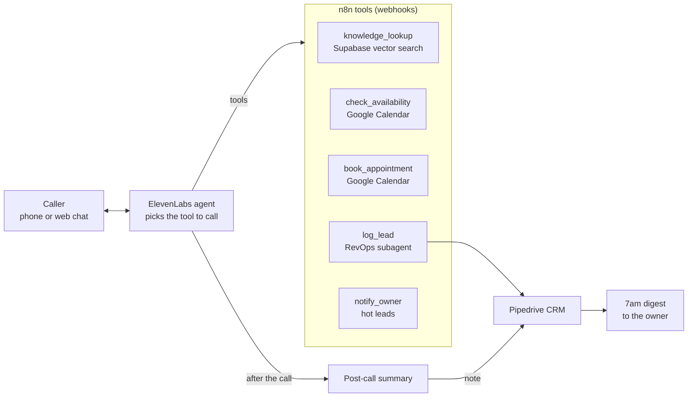

# Lead Catcher

An after-hours AI receptionist for small service businesses. A caller phones the business after closing, gets answers to their questions, books an appointment on the owner's calendar, and the owner wakes up to the lead in their CRM with a summary of the call.

Built with **ElevenLabs** (live voice agent), **n8n** (tools and back office), **Supabase** (knowledge base vector search), **Google Calendar** and **Pipedrive**.

> **Status: in progress.** Sprint runs Nov 21 to 27, 2026. The voice agent, knowledge lookup and CRM subagent work today. Booking, owner notifications and the after-call summary are being built this week. See [Roadmap](#roadmap).

## The problem

Small businesses lose leads every night. A potential client calls at 8pm, gets voicemail, and calls a competitor instead. Calendly only helps once someone has already decided to book. It can't answer "do you handle small business taxes?" or tell a caller you're closed on Sundays.

Lead Catcher picks up the phone, answers from the business's own information, books the appointment, and logs the lead.

## Architecture

The ElevenLabs agent only talks and decides which tool to call. Every action runs as its own n8n webhook, so each piece can be tested alone with curl before it goes on a live call.



## What's in this repo

Workflows are grouped the same way as the n8n folders: one folder per client, plus `shared/` for subagents that more than one client or system calls.

```
workflows/
├── ledgerlight/   ← everything specific to the Ledgerlight demo
├── shared/        ← reusable subagents: RevOps, Prospecting, SDR
└── experiments/   ← earlier voice experiments, kept for reference
```

| Path | What it is | Status |
|---|---|---|
| `workflows/ledgerlight/knowledge-lookup.json` | Webhook the voice agent calls to answer questions from the knowledge base (OpenAI agent + Supabase vector store, header auth) | Working |
| `workflows/ledgerlight/kb-ingest.json` | Upload form that splits a Markdown knowledge base on its headings and loads it into Supabase with OpenAI embeddings | Working |
| `workflows/shared/revops-subagent.json` | Reusable across clients and the outbound sales agent. Turns a plain-text lead into structured JSON, then creates the organization, person, lead and note in Pipedrive | Working |
| `workflows/shared/prospecting-subagent.json` | Finds 5 prospects for a query with Firecrawl search and Hunter, returning structured, sourced leads. Never guesses emails | Working |
| `workflows/shared/sdr-subagent.json` | Reads people from Pipedrive and drafts a pitch email for each in Gmail. Drafts only, a person reviews and sends | Working |
| `elevenlabs/ledgerlight-receptionist.json` | Full ElevenLabs agent config: voice, model, first message and the `knowledge_lookup` tool | Working |
| `workflows/experiments/` | Earlier voice experiments: ElevenLabs calling n8n, and n8n replying with ElevenLabs text-to-speech | Reference |
| `prompts/` | System prompts and output schemas, kept as files so changes show up as readable diffs | |
| `knowledge-base/ledgerlight.md` | Knowledge base for Ledgerlight Tax & Advisory, the fictional CPA firm used in the demo | Loaded |

## Roadmap

- [x] Live voice agent (ElevenLabs)
- [x] Knowledge lookup over Supabase (RAG)
- [x] RevOps subagent writing leads to Pipedrive
- [x] Header auth on the knowledge lookup webhook
- [ ] Header auth on every other webhook
- [ ] `check_availability` (Google Calendar)
- [ ] `book_appointment`
- [ ] `log_lead` wired to the RevOps subagent
- [ ] `notify_owner` for hot leads
- [ ] Post-call summary from the ElevenLabs transcript
- [ ] 7am digest email
- [ ] Real phone number
- [ ] Demo video
- [ ] Move to AWS (Lambda, API Gateway, Bedrock) as a multi-tenant service

## Setup

1. In n8n, import the files in `workflows/ledgerlight/` and `workflows/shared/` (Workflows → Import from File).
2. Reconnect credentials on each node: OpenAI, Supabase, Header Auth, Pipedrive, Hunter, Gmail and Firecrawl. Credential IDs were removed from the exports.
3. Run the ingestion workflow, open its form, and upload `knowledge-base/ledgerlight.md` (or your own business's file). Chunks are tagged `source: ledgerlight-kb` so they can be deleted and reloaded cleanly.
4. Add header auth to each Webhook node before activating it.
5. In ElevenLabs, create an agent from `elevenlabs/ledgerlight-receptionist.json` (or copy the prompt from `prompts/ledgerlight-receptionist.md`). Replace the placeholder webhook URL with your own, and point the `x-api-key` header at a workspace secret holding the same value as the n8n Header Auth credential.

The ingestion workflow and the lookup workflow must use the **same OpenAI embedding model**, or retrieval quietly returns poor matches instead of erroring.

## What broke and what I learned

- **Agent tools vs. a fixed workflow.** The first version of the RevOps subagent gave the agent four Pipedrive tools. It sometimes skipped them and returned JSON straight away, because the output parser offered an easier way to finish. Moving the Pipedrive steps out of the agent and into a fixed sequence of nodes (organization, then person, then lead, then note) made every run create all four records. The agent now does only what models are good at: turning messy text into structure.
- **Disabled nodes pass data through.** An organization ID kept coming back `undefined` because the Pipedrive nodes were still switched off from testing. A disabled n8n node hands its input along unchanged, so the next node never saw an `id`.
- **Deleting a person in Pipedrive can take their lead with it.** I thought lead creation was broken. It had worked; I had deleted the test person afterwards.
- **ElevenLabs Voice Library voices need a paid plan through the API.** On the free tier, a Library voice returns `402 Payment Required`. Default voices work.

## Security notes

- No API keys are stored in these files. All secrets live in n8n credentials.
- Saved test data (`pinData`), sheet IDs, webhook paths and email addresses were stripped before publishing.
